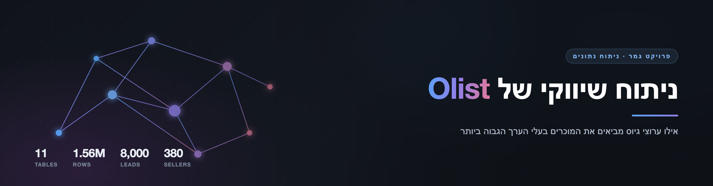

<div align="center">



<p>


</p>

</div>

<div dir="rtl">

## שאלת המחקר

> **האם הערוצים שמביאים ל-Olist הכי הרבה מוכרים הם גם אלה שמביאים את המוכרים בעלי הערך הגבוה ביותר?**

מתוך השאלה הזו נגזרות שלוש שאלות משנה:

1. האם דירוג הערוצים לפי כמות המוכרים שונה מהדירוג לפי ההכנסות שהם ייצרו?
2. האם מוכר שמייצר הכנסות גבוהות הוא בהכרח מוכר בעל ערך?
3. כמה שווה הסטה של מאמץ הגיוס לערוצים בעלי הערך הגבוה?

נתוני משפך השיווק של Olist מראים כמה מוכרים כל ערוץ הביא, אבל לא כמה טובים המוכרים האלה היו בפועל. הפרויקט מחבר את נתוני המשפך, 8,000 לידים ו-842 עסקאות שנחתמו, למה שכל מוכר עשה בפלטפורמה אחרי החתימה, ובונה ציון ערך למוכר משלושה רכיבים: הכנסות, התמדה ושביעות רצון.

פרויקט גמר בניתוח נתונים, תוכנית ניצנים. מאת אלכס רבינוביץ' ואליזבט דמיאנוב, בהנחיית ד"ר חזי. **הפרויקט הושלם והוצג.**

## מה מצאנו

**בין ערוצי השיווק לא נמצא הבדל מדיד, לא באיכות המוכרים שהם מביאים ולא בשיעור המוכרים שמתחילים למכור בתוך תשעים יום. הערוצים נבדלים בבירור רק לפני החתימה, בשיעור שבו לידים הופכים לעסקאות.**

* **איכות.** ציון הערך חושב ל-341 מוכרים, ו-243 מהם נמצאים בארבעת הערוצים שיש בהם מספיק מוכרים להשוואה. ממוצעי הציון בערוצים האלה נעים בין 52.4 ל-59.4, ופער כזה מתקבל בכ-28 אחוזים מהחלוקות האקראיות של המוכרים לערוצים. המדגם היה מזהה, בסיכוי של 80 אחוזים, רק פער של כאחת עשרה נקודות ומעלה, ולכן זו אי יכולת להבחין ולא הוכחה שאין הבדל.
* **התחלת מכירה.** מתוך 665 העסקאות שהיו להן תשעים ימים מלאים, בתוך תשעים יום מהחתימה התחילו למכור 55.5 אחוזים מהמוכרים שהגיעו מחיפוש ממומן, לעומת 40.6 אחוזים מאלה שהגיעו מחיפוש אורגני. זהו הפער הגדול ביותר בין ערוצי השיווק, והוא עקבי בכל החלונות, אבל אחרי תיקון לעשר ההשוואות האפשריות ביניהם הוא אינו מובהק.
* **לפני החתימה.** שיעור ההמרה מליד לעסקה נע בין 5.6 אחוזים ברשתות החברתיות ל-12.3 אחוזים בחיפוש הממומן, הבדל מובהק בבירור.
* **הכנסות וערך.** הכנסות גבוהות אינן מלוות בביקורות טובות יותר, אך מלוות בהתמדה ארוכה יותר.

**התובנה.** מתוך 665 העסקאות שהיו להן תשעים ימים מלאים, 373 לא הגיעו למכירה בתוך תשעים יום, ו-320 מהן לא הגיעו למכירה כלל עד סוף הנתונים. המוכרים האלה קיימים בכל הערוצים, ותמהיל הערוצים משנה מעט מולם: גם אילו הפער הגדול ביותר היה אמיתי, הסטת חמישית מלידי החיפוש האורגני לממומן הייתה מוסיפה כתשעה מוכרים בלבד.

| השאלה | התשובה בקצרה |
|---|---|
| השאלה המרכזית | לא נמצא הבדל מדיד בין הערוצים באיכות המוכרים, ולכן אי אפשר לומר שערוץ כלשהו מביא מוכרים טובים יותר |
| שאלת משנה 1 | הדירוגים לפי כמות, הכנסות והפעלה שונים זה מזה, אך אף אחד מהם אינו נשען על הבדל מובהק |
| שאלת משנה 2 | לא בהכרח. הכנסות גבוהות אינן מלוות בשביעות רצון גבוהה יותר, אך מלוות בהתמדה ארוכה יותר |
| שאלת משנה 3 | מעט. כתשעה מוכרים נוספים, גם בהנחה הנוחה ביותר |

הנימוקים, הנתונים והתרשימים נמצאים ב[ספר הפרויקט](book/book.md), ולצידו [גרסה להדפסה](book/book.pdf) של אותו ספר. מצגת הסיום נמצאת ב[קובץ המצגת](presentation/olist_presentation.pdf). היא הוצגה לפני תיקון אחרון בתאריך סוף הנתונים, ולכן חלק מהמספרים בה שונים מאלה שבספר: היא מונה 748 עסקאות כשירות במקום 665, ומתארת את הפער בין החיפוש הממומן לאורגני כגבולי, בעוד שבנתונים המתוקנים הוא אינו עומד בתיקון. המסקנות העיקריות לא השתנו.

## מה יש במאגר

<div dir="ltr">

```
.
├── data/
│   ├── raw/          Olist source CSVs, exactly as downloaded
│   ├── clean/        final_*.csv, built by notebook 02
│   └── README.md     what each data folder holds
├── notebooks/        01 review, 02 preparation, 03 analysis, 04 charts
├── book/             the project book: book.md, and book.pdf to print
│   └── figures/      charts built by notebook 03
├── charts/           presentation charts (seaborn), built by notebook 04
├── presentation/     the final presentation, as presented (PDF)
├── assets/           README images
├── DATA_SCHEMA.pdf   table reference
├── PROJECT_LOG.md    work journal
├── LICENSE           MIT, for the code and text
├── requirements.txt  Python dependencies
└── README.md         this file
```

</div>

* **מחברות.** [מחברת 01](notebooks/01_data_review.ipynb) סוקרת את הנתונים הגולמיים ומרכזת את הכללים לניתוח. [מחברת 02](notebooks/02_data_preparation.ipynb) מיישמת אותם ובונה את שלושת הקבצים הנקיים, שנשמרים בתיקייה `data/clean` לשימוש המחברות הבאות. [מחברת 03](notebooks/03_analysis.ipynb) מריצה את כל המבחנים ובונה את תרשימי הספר. [מחברת 04](notebooks/04_charts.ipynb) בונה גרסאות מעוצבות של אותם תרשימים לתיקייה `charts`, להצגה ולשקפים. לכל המחברות יש פלטים שמורים, ואפשר לקרוא אותן בלי להריץ.
* **ספר הפרויקט.** תקציר, פרק מתודולוגיה שמתעד כל החלטה, שישה פרקים של ממצאים, מסקנות ומגבלות, וסיכום של מהלך העבודה.
* **יומן העבודה.** הקובץ [PROJECT_LOG.md](PROJECT_LOG.md) מתעד את מהלך הפרויקט לפי תאריכים, כולל טעויות שנמצאו ותוקנו.

## הנתונים והרישיון

הנתונים הם שני מאגרים ציבוריים שפרסמה חברת Olist באתר Kaggle, והם: [Brazilian E-Commerce Public Dataset by Olist](https://www.kaggle.com/datasets/olistbr/brazilian-ecommerce) ו-[Marketing Funnel by Olist](https://www.kaggle.com/datasets/olistbr/marketing-funnel-olist), מאגר משפך השיווק. שניהם מופצים ברישיון [CC BY-NC-SA 4.0](https://creativecommons.org/licenses/by-nc-sa/4.0/), שמתיר שימוש לא מסחרי עם ייחוס. הקבצים שבתיקייה `data/raw` הם עותק של המאגרים האלה בלי שום שינוי, והקבצים שבתיקייה `data/clean` נגזרים מהם, ולכן גם הם כפופים לאותו רישיון: שימוש לא מסחרי בלבד, עם ייחוס לחברת Olist ושיתוף בתנאים זהים.

הקוד והטקסט שכתבנו מופצים ברישיון MIT, שמופיע ב[קובץ הרישיון](LICENSE) שבתיקיית הבסיס. רישיון ה-MIT אינו חל על הנתונים שבתיקייה `data`, שכפופים לרישיון של Olist שמתואר למעלה.

התיקייה `data/raw` כוללת 11 טבלאות ו-1,559,764 שורות, ופקודת `git clone` מביאה גם אותן, בלי שלב הורדה ובלי צורך בחשבון באתר. תיעוד של כל טבלה, עמודה ומפתח נמצא בקובץ [DATA_SCHEMA.pdf](DATA_SCHEMA.pdf), ופירוט של התיקיות נמצא ב[קובץ התיאור של תיקיית הנתונים](data/README.md).

## התקנה והרצה

הפרויקט דורש Python בגרסה 3.12 ומעלה, משום שהספרייה `scipy` בגרסה הנעולה דורשת זאת. מתוך תיקיית הבסיס של הפרויקט:

**ב-Windows:**

<div dir="ltr">

```
py -m venv .venv
.venv\Scripts\activate
pip install -r requirements.txt
jupyter notebook
```

</div>

**ב-macOS או ב-Linux:**

<div dir="ltr">

```
python3 -m venv .venv
source .venv/bin/activate
pip install -r requirements.txt
jupyter notebook
```

</div>

את המחברות מריצים מתוך התיקייה `notebooks`, לפי הסדר. מחברת 02 בונה מחדש את הקבצים שבתיקייה `data/clean`, מחברת 03 את תרשימי הספר, ומחברת 04 את תרשימי ההצגה. הגרסאות בקובץ `requirements.txt` נעולות, כך שהרצה מחדש אמורה לתת את אותן תוצאות.

## גבולות הניתוח

* **אין טענות על עלות גיוס או על החזר השקעה.** אין במאגר נתוני עלות, ולכן הסימולציה מנוסחת במוכרים ולא בכסף.
* **אין טענות סיבתיות.** השיעורים נצפו בנתונים ולא נמדדו בניסוי, ולכן אי אפשר לדעת אם הערוץ הוא שגורם להבדל.
* **משפך השיווק הוא מדגם אקראי.** 8,000 הלידים הם מדגם מתוך כלל הלידים של החברה, ולכן המספרים המוחלטים אינם נפח הגיוס שלה.
* **הסימולציה מראה כיוון וסדר גודל, לא תחזית.** הטווח שהיא מדווחת משקף את אי הוודאות בשיעורים, ולא בהנחות שהיא נשענת עליהן.

</div>
