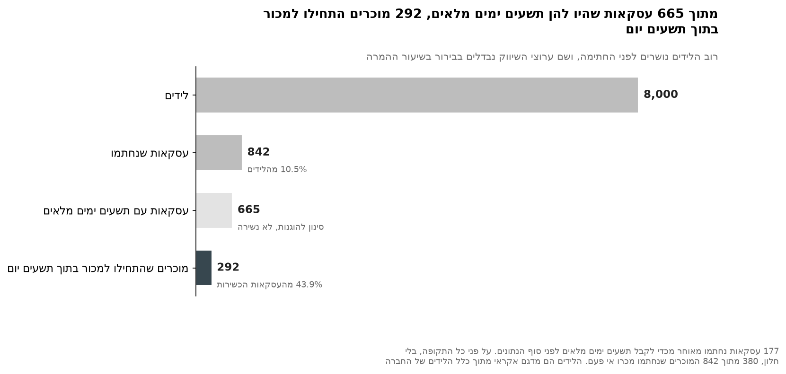
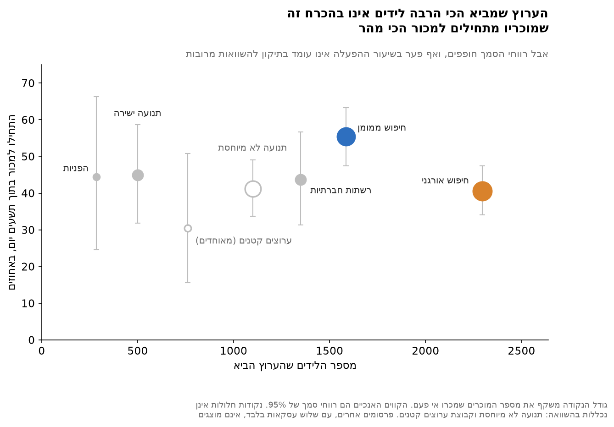
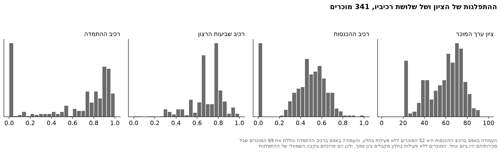
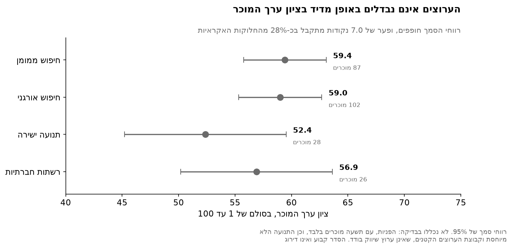
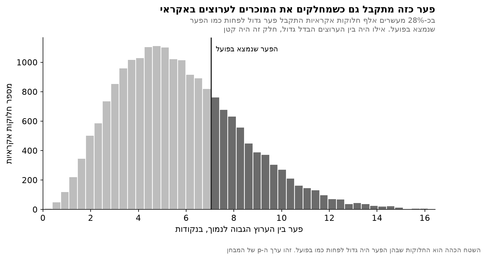
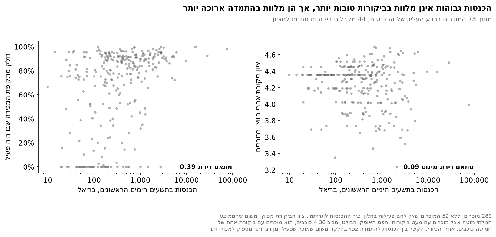
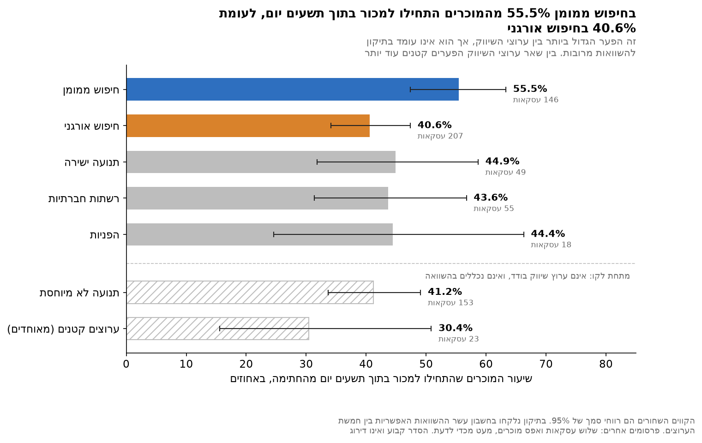
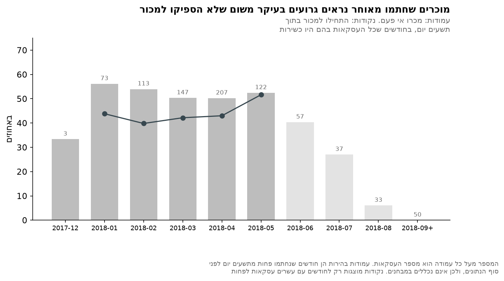
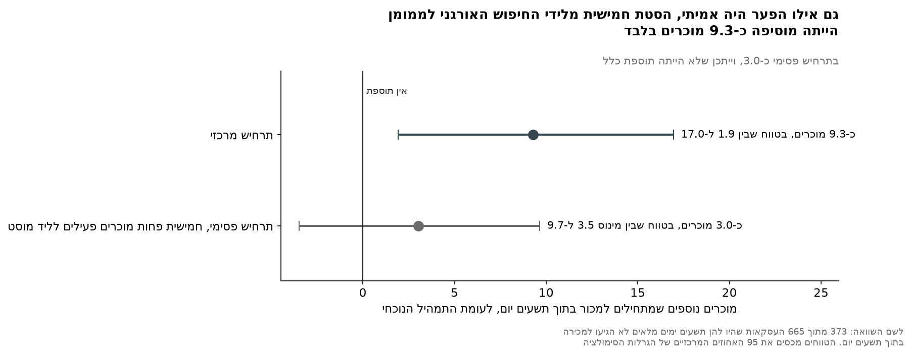

<div dir="rtl">

# ניתוח שיווקי של Olist

## ספר הפרויקט

**מאת:** אלכס רבינוביץ', אליזבט דמיאנוב

**בהנחיית:** ד"ר חזי

---

# תקציר

חברת Olist היא פלטפורמה ברזילאית שמחברת מוכרים קטנים לאתרי מכירות גדולים, והיא מגייסת את המוכרים דרך כמה ערוצי שיווק. הפרויקט שואל אם הערוצים שמביאים הכי הרבה מוכרים הם גם אלה שמביאים את המוכרים הטובים ביותר. לשם כך חיברנו את משפך השיווק של החברה, 8,000 לידים ו-842 עסקאות שנחתמו, למה שכל מוכר עשה בפלטפורמה אחרי החתימה, ובנינו ציון ערך למוכר משלושה רכיבים: הכנסות, התמדה ושביעות רצון.

**מה מצאנו.** בין ערוצי השיווק לא נמצא הבדל מדיד, לא באיכות המוכרים שהם מביאים, כפי שהיא נמדדת בציון הערך, שהושווה בין 243 מוכרים בארבעה ערוצים, ולא בשיעור המוכרים שמתחילים למכור בתוך תשעים יום מהחתימה, שנמדד על 665 עסקאות. הפער הגדול ביותר בין ערוצי השיווק אחרי החתימה הוא בין החיפוש הממומן לחיפוש האורגני: 55.5 אחוזים מהמוכרים של הראשון התחילו למכור בתוך תשעים יום, לעומת 40.6 אחוזים מהמוכרים של השני. אחרי תיקון למספר ההשוואות שנערכו, הפער הזה אינו מובהק. ההבדל הברור היחיד בין הערוצים הוא לפני החתימה, בשיעור שבו לידים הופכים לעסקאות. בנוסף, לא נמצא קשר בין הכנסות גבוהות לביקורות טובות יותר, אך הכנסות גבוהות מלוות בהתמדה ארוכה יותר.

**התובנה.** יותר ממחצית העסקאות שהיו להן תשעים ימים מלאים, 373 מתוך 665, לא הגיעו למכירה בתוך תשעים יום, ו-320 מהן לא הגיעו למכירה כלל עד סוף הנתונים. המוכרים האלה קיימים בכל הערוצים. בחירת תמהיל ערוצים היא מנוף קטן מולם: גם אילו הפער בין החיפוש הממומן לאורגני היה אמיתי, הסטת חמישית מלידי החיפוש האורגני הייתה מוסיפה כתשעה מוכרים בלבד. הנתונים מראים היכן ומתי מוכרים נושרים, אך לא מה יגרום להם להתחיל למכור.

**גבולות.** אין בנתונים עלויות, ולכן אין בפרויקט טענה על החזר השקעה. השיעורים נצפו בנתונים ולא נמדדו בניסוי, ולכן אין בפרויקט טענה סיבתית.

---

# שאלת המחקר

> **האם הערוצים שמביאים ל-Olist הכי הרבה מוכרים הם גם אלה שמביאים את המוכרים בעלי הערך הגבוה ביותר?**

מתוך השאלה הזו נגזרות שלוש שאלות משנה:

1. האם דירוג הערוצים לפי כמות המוכרים שונה מהדירוג לפי ההכנסות שהם ייצרו?
2. האם מוכר שמייצר הכנסות גבוהות הוא בהכרח מוכר בעל ערך?
3. כמה שווה הסטה של מאמץ הגיוס לערוצים בעלי הערך הגבוה?

נתוני משפך השיווק של Olist מראים כמה מוכרים כל ערוץ הביא. הם לא מראים כמה טובים המוכרים האלה היו בפועל. הפרויקט מחבר את נתוני המשפך למה שכל מוכר עשה בפלטפורמה אחרי החתימה, ושואל אם הכמות והאיכות מצביעות על אותם ערוצים.

## התוכנית שאיתה יצאנו לדרך

**א. כמות מול הכנסות.** לדרג את ערוצי הגיוס לפי מספר המוכרים שהמירו, ואז לדרג אותם שוב לפי ההכנסות שאותם מוכרים ייצרו בהמשך.

**ב. ציון ערך למוכר.** הכנסות לבדן הן הגדרה צרה מדי למוכר טוב, ולכן לבנות ציון משלושה רכיבים, הכנסות, משך פעילות ושביעות רצון, ולבדוק אותו לפני השימוש בו.

**ג. ערך לפי ערוץ וסימולציה.** לסכם את הציון לפי הערוץ שגייס כל מוכר, ולדמות כמה שווה הסטה של מאמץ הגיוס לערוצים הטובים יותר.

השאלה והתוכנית נשארות כפי שנוסחו לפני הניתוח, גם לאחר שהתברר שהנתונים אינם יכולים לענות על כל חלקיהן. שינוי בדיעבד של השאלה כך שתתאים לממצאים היה פוגם בתוקף המחקר.

## גבולות הניתוח

הגבולות האלה נקבעו מראש, והעבודה נבנתה בתוכם.

* **הסימולציה מנוסחת ביחידות של מאמץ גיוס, לא בתקציב.** אין בנתונים סכומי הוצאה, ולכן ההסטה מבוטאת כחלק מהלידים שעובר בין ערוצים.
* **אין טענות על עלות גיוס או על החזר השקעה.** שני המדדים דורשים נתוני עלות שאינם קיימים במאגר.
* **משפך השיווק הוא מדגם אקראי.** 8,000 הלידים הם מדגם מתוך כלל הלידים של Olist, כפי שמצוין בתיאור הרשמי של המאגר. השיעורים וההשוואות אינם מוטים בגלל זה, בהנחה שהדגימה אקראית, אך המספרים המוחלטים אינם נפח הגיוס של החברה.
* **הסימולציה מראה כיוון וסדר גודל, לא תחזית.** היא נשענת על הנחות מוצהרות.

## התשובות בקצרה

| השאלה | התשובה |
|---|---|
| השאלה המרכזית | לא נמצא הבדל מדיד בין הערוצים באיכות המוכרים, ולכן אי אפשר לומר שערוץ כלשהו מביא מוכרים טובים יותר, ובכלל זה שהערוצים הגדולים מביאים מוכרים טובים או גרועים יותר |
| שאלת משנה 1, דירוג לפי כמות מול דירוג לפי הכנסות | הדירוגים שונים זה מזה, אך אף אחד מהם אינו נשען על הבדל מובהק, ולכן הם תיאור בלבד |
| שאלת משנה 2, האם מוכר בעל הכנסות גבוהות הוא בעל ערך | לא בהכרח. הכנסות גבוהות אינן מלוות בשביעות רצון גבוהה יותר, אך מלוות בהתמדה ארוכה יותר |
| שאלת משנה 3, כמה שווה הסטת מאמץ הגיוס | מעט. גם בהנחה שהפער הגדול ביותר בין ערוצי השיווק אמיתי, ההסטה הייתה מוסיפה כתשעה מוכרים, מול מאות מוכרים שנחתמו ולא התחילו למכור |

---

# פרק המתודולוגיה

הפרק מתעד את ההחלטות המתודולוגיות: מדוע כל שאלה עלתה, אילו חלופות נבחנו, מה נבחר ועל סמך מה. רוב ההחלטות התקבלו לפני הניתוח, וההחלטות שהתקבלו אחריו מסומנות בגלוי. כל מספר בפרק מחושב באחת המחברות: העובדות על הנתונים הגולמיים במחברת 01, האוכלוסיות ונתוני ההכנה במחברת 02, ושאר המספרים במחברת 03, רובם בנספח ו שלה.

## מקור הנתונים

הפרויקט משתמש בשני מאגרים ציבוריים שפרסמה חברת Olist באתר Kaggle, כמפורט בטבלה:

| מאגר | תוכן | טבלאות |
|---|---|---|
| `olistbr/brazilian-ecommerce` | הפעילות בפלטפורמה: הזמנות, פריטים, תשלומים, ביקורות, לקוחות, מוכרים, מוצרים, גאולוקציה ותרגום קטגוריות | 9 |
| `olistbr/marketing-funnel-olist` | משפך השיווק: לידים ועסקאות שנסגרו | 2 |

בסך הכול 11 טבלאות ו-1,559,764 שורות. הקבצים נשמרו בתיקייה `data/raw` בדיוק כפי שהורדו. מספרי השורות נבדקו מול הקבצים עצמם, וטביעת אצבע של התיקייה נבדקת בתחילת מחברות 02 ו-03 ובסופן, כדי לוודא שהקבצים לא השתנו.

**החיבור בין שני המאגרים אפשרי בזכות טבלה אחת בלבד.** הטבלה `olist_closed_deals` מחזיקה גם מזהה ליד וגם מזהה מוכר, ולכן היא הגשר היחיד בין צד השיווק לצד המסחר.

תיעוד של כל טבלה, עמודה ומפתח נמצא בקובץ `DATA_SCHEMA.pdf` שבתיקיית הבסיס. סקירת הנתונים, כולל בדיקות השלמות וממצאי האיכות, נמצאת בקובץ `notebooks/01_data_review.ipynb`, מחברת הסקירה.

## אוכלוסיית המחקר

משפך השיווק מתחיל ב-8,000 לידים, ומהם 842 הפכו לעסקאות חתומות, שיעור של 10.5 אחוזים. כל 3,095 המוכרים בטבלת המוכרים מופיעים גם בטבלת הפריטים, ולכן הטבלה היא רישום של מוכרים שמכרו בפועל ולא של כל מי שנרשם. מתוך 842 העסקאות, 380 מוכרים מכרו עד סוף הנתונים, ו-462 לא מכרו. בהנחה שצד המסחר שלם, כפי שמוסבר בסעיף התיקוף, זו אינה תקלה בנתונים אלא תופעה עסקית, וממנה נגזר שיעור ההפעלה.

הניתוח משתמש בכמה אוכלוסיות, וכל אחת משמשת לשאלה אחרת:

| אוכלוסייה | גודל | לאיזה שימוש |
|---|---|---|
| לידים | 8,000 | המשפך |
| עסקאות שנחתמו | 842 | המשפך ושיעור ההמרה מליד לעסקה |
| עסקאות כשירות, עם תשעים ימים מלאים | 665 | מבחני ההפעלה העיקריים |
| מהן, מוכרים שהתחילו למכור בתוך תשעים יום | 292 | שיעור ההפעלה |
| מוכרים שקיבלו ציון | 341 | ציון ערך המוכר |
| מהם, מוכרים שעמודת המקור שלהם אינה ריקה | 337 | השוואת הציון בין ערוצים: 243 מהם בארבעת הערוצים שנבדקו, ו-318 כשהקטגוריה הלא ידועה נכללת |
| מוכרים עם פעילות בחלון המדידה | 289 | שאלת משנה 2 |

**מוכרים שקיבלו ציון.** הציון מחושב רק למוכרים מעסקאות כשירות, כדי שחלון המדידה של כל אחד מהם ייצפה במלואו. מתוך 665 העסקאות הכשירות, 345 מוכרים קיבלו הזמנה כלשהי. ארבעה מהם לא קיבלו אף הזמנה שסופקה, ולכן אין להם הכנסה או ביקורת, ואוכלוסיית הציון היא 341 מוכרים. ארבעה מתוך 341 מגיעים מלידים שעמודת המקור שלהם ריקה, ולכן ל-337 מוכרים יש ערך בעמודת המקור.

## סוף הנתונים וחלון תשעים הימים

### היכן נגמרים נתוני ההזמנות

**מדוע השאלה עלתה.** ההזמנה האחרונה בטבלת ההזמנות רשומה ב-17 באוקטובר 2018, אבל הנתונים עצמם נגמרים קודם. עד אמצע אוגוסט נרשמות מאות הזמנות ביום, הספירה יורדת בסוף החודש, וב-29 באוגוסט נרשמות 14 בלבד. אחרי היום הזה נרשמות 25 הזמנות בלבד בשבעה שבועות, ו-24 מהן בוטלו. מוכר שחלון התשעים יום שלו נמשך אל תוך התקופה הזו לא נצפה באמת.

**מה נבחר ולמה.** סוף הנתונים מוגדר כיום האחרון שבו נרשמו לפחות עשר הזמנות: 29 באוגוסט 2018. זהו גם היום שבו נרשמה ההזמנה האחרונה של מוכר כלשהו בקבוצת המחקר. הכלל מחושב בקוד ולא נקבע ביד.

**מה זה משנה.** בגרסה מוקדמת של הניתוח שימש התאריך 17 באוקטובר. בגרסה ההיא 83 עסקאות נחשבו לעסקאות עם תשעים ימים מלאים אף שלא היו להן, והפער בין החיפוש הממומן לאורגני עמד בתיקון להשוואות מרובות. עם סוף הנתונים האמיתי הוא אינו עומד בו. המצגת שבתיקייה `presentation` הוכנה לפני התיקון הזה, ולכן חלק מהמספרים בה שונים מאלה שבספר: היא מונה 748 עסקאות כשירות במקום 665, ומתארת את הפער בין החיפוש הממומן לאורגני כגבולי, בעוד שבנתונים המתוקנים הוא אינו עומד בתיקון. המסקנות העיקריות, שאין הבדל מדיד באיכות המוכרים ושהסטה בין ערוצים מוסיפה מעט, לא השתנו.

### חלון קבוע של תשעים יום

**מדוע השאלה עלתה.** עסקאות נחתמו עד נובמבר 2018, הרבה אחרי שנתוני ההזמנות נגמרים. מוכר שחתם מאוחר נראה גרוע רק משום שלא הספיק למכור. הטבלה מראה את שיעור המוכרים שמכרו אי פעם, לפי חודש החתימה:

| חודש חתימה | עסקאות | מכרו אי פעם |
|---|---|---|
| דצמבר 2017 | 3 | 33.3% |
| ינואר 2018 | 73 | 56.2% |
| פברואר 2018 | 113 | 54.0% |
| מרץ 2018 | 147 | 50.3% |
| אפריל 2018 | 207 | 50.2% |
| מאי 2018 | 122 | 52.5% |
| יוני 2018 | 57 | 40.4% |
| יולי 2018 | 37 | 27.0% |
| אוגוסט 2018 | 33 | 6.1% |
| ספטמבר עד נובמבר 2018 | 50 | 0% |

השיעור יציב בחודשים הראשונים של 2018 וצונח מיוני ואילך עד לאפס. הירידה הזו משקפת את הזמן שעמד לרשות המוכר, ולא את איכותו.

**החלופות שנשקלו.** כל העסקאות בלי תיקון; חיתוך לפי תאריך חתימה בלבד, שבו כל מוכר נמדד עד סוף הנתונים, ולכן מוכר ותיק נמדד על תקופה ארוכה יותר; או חלון תצפית קבוע מרגע החתימה של כל עסקה.

**מה נבחר ולמה.** חלון קבוע של תשעים ימים קלנדריים מרגע החתימה, והיום התשעים נכלל בפנים. עסקה נכללת בהשוואה רק אם חלפו לפחות תשעים יום בין החתימה לסוף הנתונים, כלומר אם נחתמה עד 31 במאי 2018. הכלל משאיר 665 מתוך 842 העסקאות. 177 העסקאות האחרות נחתמו מאוחר מדי, ו-53 מהן אחרי שהנתונים כבר נגמרו. חלון של תשעים יום לוכד 84.6 אחוזים מהעסקאות הכשירות שהגיעו למכירה אי פעם. כבדיקה נוספת חושב גם חלון של 120 יום, על 543 העסקאות שהיו להן 120 ימים מלאים.

### הגדרת הפעלה

מוכר נחשב מופעל אם ההזמנה הראשונה שלו נרשמה בתוך תשעים יום מהחתימה, **בכל סטטוס שהוא**. זהו המקום היחיד בפרויקט שאינו מסונן להזמנות שסופקו: הפעלה היא השאלה אם המוכר התחיל למכור, והזמנה שבוטלה היא עדיין תחילת מכירה. מוכר שהתחיל למכור אחרי היום התשעים נספר כלא מופעל, ולכן השיעור מודד מהירות עד המכירה הראשונה.

## ציון ערך המוכר

הציון נע בסולם 1 עד 100 ומחושב לכל מוכר בנפרד. הוא ממוצע של שלושה רכיבים, וכל רכיב מנורמל לטווח 0 עד 1 בתוך קבוצת המחקר.

1. **הכנסות.** סכום העמודה `price` בטבלת הפריטים, בתשעים הימים הראשונים מרגע החתימה, בסולם לוגריתמי. העמודה הזו משמשת במקום סכום התשלום, משום ש-1,278 הזמנות מכילות פריטים של יותר ממוכר אחד, ואי אפשר לפצל ביניהם את התשלום.
2. **משך פעילות, או התמדה.** מספר הימים בין ההזמנה הראשונה לאחרונה של המוכר, מחולק במספר הימים מההזמנה הראשונה ועד סוף הנתונים. כלומר החלק מתקופת המכירה שבו המוכר היה פעיל.
3. **שביעות רצון.** ממוצע ציוני הביקורת על הזמנות המוכר באותם תשעים ימים, אחרי כיווץ כלפי הממוצע הכללי.

**שורות חוזרות בטבלת הפריטים.** בטבלה יש 7,088 צירופים של הזמנה ומוצר שמופיעים יותר מפעם אחת. אלה אינן כפילויות אלא כמות: אותו מוצר שנרכש פעמיים באותה הזמנה מופיע בשתי שורות, לכל אחת מספר סידורי ומחיר משלה. לכן אסור להסיר אותן, וסכימה פשוטה של העמודה `price` היא החישוב הנכון.

**החישוב:**

<div dir="ltr">

```
revenue_component      = scale( log10(revenue + 1) )
tenure_component       = scale( active_span_days / tenure_exposure_days )
satisfaction_component = scale( (n * seller_mean + k * global_mean) / (n + k) ),  k = 5

value_score = 1 + 99 * mean(revenue_component, tenure_component, satisfaction_component)
```

</div>

הפונקציה `scale` היא נרמול מינימום-מקסימום לטווח 0 עד 1. במונחים של הנוסחה, `n` הוא מספר הביקורות של המוכר בחלון, `seller_mean` הוא ממוצע הביקורות שלו בחלון, ו-`global_mean` הוא ממוצע כל הביקורות שבתוך חלונות המדידה, 4.229 כוכבים.

**היקף המדידה.** ההכנסות ושביעות הרצון נמדדות בחלון של תשעים יום מהחתימה, כך שכל מוכר נמדד על פני אותו פרק זמן. משך הפעילות אינו מוגבל לחלון, משום שהוא כבר מנורמל לזמן שעמד לרשות המוכר. החלון משאיר מחוץ לחישוב 45.5 אחוזים מההכנסות של המוכרים שקיבלו ציון. זהו מחיר מודע: בלעדיו, מוכר שחתם בדצמבר 2017 היה נמדד על כתשעה חודשים של מכירות, ומוכר שחתם במאי על שלושה בלבד.

**מוכרים בלי פעילות בחלון.** 52 מוכרים לא רשמו אף הכנסה ואף ביקורת בתוך תשעים הימים. הם מקבלים את הרצפה ברכיב ההכנסות ואת הממוצע הכללי ברכיב שביעות הרצון, משום שהכיווץ עם אפס ביקורות מחזיר בדיוק את הממוצע. מספרם מצוין בתרשימי ההתפלגות של הציון ובשאלת המשנה השנייה.

### סינון לפי סטטוס הזמנה

**מדוע השאלה עלתה.** 2,963 הזמנות בכלל הנתונים לא הגיעו לסטטוס שסופק, וציון הביקורת הממוצע בהן נמוך בהרבה: 4.16 בהזמנות שסופקו, ובין 1.28 ל-2.01 בכל סטטוס אחר שיש בו יותר ממאה ביקורות.

**מה נבחר ולמה.** ההכנסות, הביקורות ומשך הפעילות נמדדים על הזמנות שסופקו בלבד. אחרת הציון היה רושם הכנסה מהזמנות מבוטלות, ומודד כשל לוגיסטי כאי שביעות רצון מהמוכר.

### ביקורת אחת לכל הזמנה

**מדוע השאלה עלתה.** בטבלת הביקורות 99,224 שורות, אך רק 98,673 הזמנות שונות. 547 הזמנות קיבלו יותר מביקורת אחת, וב-202 מהן הציונים שונים. חיבור הביקורות לטבלת הפריטים בלי לצמצם קודם לשורה אחת לכל הזמנה מנפח שורות ומכפיל הכנסות.

**מה נבחר ולמה.** לכל הזמנה נבחרת הביקורת הראשונה לפי תאריך. מכיוון שעמודת התאריך מכילה יום בלבד, ו-155 הזמנות קיבלו את כל הביקורות שלהן באותו יום, שבירת השוויון נעשית לפי שעת המענה לביקורת, שהיא ייחודית. ההכנסות מחושבות מטבלת הפריטים בלבד, והביקורות מחוברות רק אחרי הצמצום.

### לפי איזה תאריך ביקורת נכנסת לחלון

**מדוע השאלה עלתה.** לביקורת יש שני תאריכים אפשריים: מועד הרכישה של ההזמנה, ומועד כתיבת הביקורת, שמגיע רק אחרי האספקה.

**מה נבחר ולמה.** מועד הרכישה. כך ההכנסות והביקורות נמדדות על אותו ציר זמן ומתייחסות לאותה פעילות מכירה. החלופה הייתה משאירה בחלונות 1,774 ביקורות במקום 2,227, ומזיזה את הממוצע הכללי מ-4.229 ל-4.242 בלבד. מספר המוכרים בלי פעילות בחלון נשאר 52 בשתי החלופות.

### פיזור ההכנסות

**מדוע השאלה עלתה.** ההכנסות מרוכזות מאוד. מוכר אחד אחראי ל-22.4 אחוזים מההכנסות בתוך חלונות המדידה, ועשרת הגדולים ל-47.7 אחוזים.

**החלופות שנשקלו.** נרמול ליניארי, לוגריתם, דירוג אחוזוני או קיטום הערכים הגבוהים.

**מה נבחר ולמה.** לוגריתם בבסיס עשר. בנרמול ליניארי מחצית המוכרים האמצעית תופסת פחות מנקודה אחת מתוך מאה, והציון היה מבחין בעיקר במוכר הגדול. הלוגריתם נותן למחצית האמצעית טווח של 23 נקודות ושומר על קשר לגודל ההכנסה. דירוג אחוזוני נדחה משום שהוא מוחק את הגודל לגמרי, וקיטום נדחה משום שהריכוז אינו רק בקצה אלא לאורך כל ההתפלגות.

### מיעוט ביקורות

**מדוע השאלה עלתה.** 245 מתוך 341 המוכרים קיבלו פחות מחמש ביקורות בחלון, וחציון מספר הביקורות הוא שתיים. 65 מוכרים היו מקבלים ציון מושלם על סמך ביקורת אחת.

**החלופות שנשקלו.** ממוצע גולמי, כיווץ כלפי הממוצע הכללי, דרישת מינימום של חמש ביקורות, או שיעור הביקורות החיוביות.

**מה נבחר ולמה.** כיווץ בייסיאני בעוצמה של חמש, כלומר מוכר עם חמש ביקורות ממוקם באמצע הדרך בין הממוצע שלו לממוצע הכללי. דרישת מינימום נדחתה משום שהייתה מוציאה 245 מוכרים, ודווקא את בעלי הפעילות הנמוכה. מלבד המשקלות, עוצמת הכיווץ היא הפרמטר החופשי היחיד בציון, ולכן היא נבדקה גם בעוצמות 2 ו-10. הפער הגדול ביותר בין הערוצים נע בין 6.83 ל-7.16 נקודות, ואותם ערוצים נשארים בקצוות.

### מדידת משך הפעילות

**מדוע השאלה עלתה.** משך הפעילות הגולמי מתואם מינוס 0.37 עם מועד החתימה, במתאם ספירמן. מוכר שהצטרף מאוחר אינו יכול להציג משך פעילות ארוך, ולכן המדד הגולמי מעניש אותו על עיתוי.

**מה נבחר ולמה.** משך הפעילות מחולק בזמן שעמד לרשות המוכר, מההזמנה הראשונה ועד סוף הנתונים. אחרי הנרמול המתאם עם מועד החתימה הוא מינוס 0.06, כמעט אפס. מכנה אחר, הימים מאז החתימה, נדחה: הוא שולט בכשירות העסקה ואינו מודד את תקופת המכירה של המוכר.

**מוכרים עם משך אפס.** 69 מוכרים ביצעו את כל מכירותיהם ביום אחד, 68 מהם בהזמנה אחת, והם מקבלים את הציון המינימלי ברכיב הזה. הזמנה אחת אינה משך פעילות, ולכן הציון משקף את המציאות.

### משקלות הרכיבים

**מדוע השאלה עלתה.** הרכיבים אינם בלתי תלויים: ההכנסות ומשך הפעילות מתואמים 0.50, ושביעות הרצון כמעט אינה מתואמת עם אף אחד מהם.

**מה נבחר ולמה.** משקלות שווים. הם שקופים ואינם נגזרים מהנתונים. משקלות מניתוח רכיבים ראשיים נדחו, משום שהם נותנים לשביעות הרצון משקל של 0.05 בלבד, ובכך מוחקים רכיב שנבחר בכוונה.

**הסתייגות.** משקלות שווים אינם השפעה שווה. אחרי הנרמול לכל רכיב פיזור אחר, ופירוק השונות של הציון מראה שמשך הפעילות אחראי ל-61 אחוזים ממנה, ההכנסות ל-31 אחוזים ושביעות הרצון ל-8 אחוזים. בפועל השפעת שביעות הרצון על הציון קטנה. בדיקת רגישות של 500 צירופי משקלות אקראיים מופיעה במחברת 03, בנספח ה.

## תכנון ההשוואות

### הפעלה וערך כשתי תוצאות נפרדות

**מדוע השאלה עלתה.** 320 מתוך 665 העסקאות הכשירות לא הגיעו למכירה כלל עד סוף הנתונים. אפשר היה לתת להן ציון אפס ולאחד את שתי השאלות, כמה מוכרים מתחילים למכור וכמה הם טובים, למדד אחד.

**מה נבחר ולמה.** שתי תוצאות נפרדות: שיעור ההפעלה, וציון הערך של מי שכן מכר. מדד מאוחד היה מערבב בין המנגנונים. דוגמה לכך היא התנועה הישירה: שיעור ההפעלה שלה, 44.9 אחוזים, הוא השני בגובהו מבין הערוצים, אך ממוצע הציון של המוכרים שלה הוא הנמוך מבין הערוצים שנבדקו. אף אחד מההבדלים האלה אינו מובהק, אך מדד מאוחד היה מטשטש את הכיוונים המנוגדים.

### משפחת ההשוואות

**מדוע השאלה עלתה.** כשמשווים ערוצים בזוגות, כל השוואה נוספת מגדילה את הסיכוי שאחת מהן תיראה מובהקת במקרה, ולכן ערך ה-p מתוקן לפי מספר ההשוואות. המספר תלוי בשאלה אילו קבוצות נחשבות ערוצים.

**החלופות שנשקלו.** עשרה זוגות בין חמשת ערוצי השיווק המזוהים; 15 זוגות בתוספת הקטגוריה הלא ידועה; או 21 זוגות, כשגם קבוצת הערוצים הקטנים נספרת כקבוצה.

**מה נבחר ולמה.** עשרת הזוגות שבין חמשת ערוצי השיווק: חיפוש ממומן, חיפוש אורגני, תנועה ישירה, רשתות חברתיות והפניות. הקטגוריה הלא ידועה וקבוצת הערוצים הקטנים אינן ערוצים שאפשר לרכוש מהם עוד לידים. שלוש המשפחות מדווחות תמיד זו לצד זו, יחד עם שלוש שיטות תיקון: בונפרוני, הולם ובנימיני-הוכברג.

**עיתוי הבחירה.** בשלב החקירה נקבעה משפחה של 15 זוגות. המעבר לעשרה נעשה אחרי שהתברר, בגרסה המוקדמת של הניתוח, שמשפחה של 21 זוגות אינה עוברת. בנתונים המתוקנים אף זוג אינו עומד בתיקון באף אחת משלוש המשפחות, ולכן הבחירה אינה משנה את המסקנה.

### ערוצים קטנים

**מדוע השאלה עלתה.** בכמה ערוצים יש מעט מאוד עסקאות, ומתחת לכעשרים עסקאות רווח הסמך על שיעור ההפעלה רחב כל כך שהשיעור אינו אומר דבר.

**מה נבחר ולמה.** ערוץ עם עשרים עסקאות ומעלה מוצג בשורה נפרדת, והשאר, דואר אלקטרוני, תצוגה ואחרים, מאוחדים לקבוצה אחת. הסף נספר על כל העסקאות. ערוץ ההפניות נשאר בשורה נפרדת: יש בו 24 עסקאות, אך רק 18 מהן כשירות ורק תשעה מהמוכרים שלו קיבלו ציון, ולכן רווח הסמך על שיעור ההפעלה שלו רחב. הערוץ `other_publicities` מוצג כהערת שוליים: 65 לידים, שלוש עסקאות ואפס מוכרים. אותו סף של עשרים קובע גם אילו ערוצים נכנסים למבחן על ציון הערך, הפעם לפי מספר המוכרים שקיבלו ציון.

### הקטגוריה הלא ידועה

**מדוע השאלה עלתה.** הערך `unknown` בעמודת המקור הוא קטגוריה אמיתית בנתוני המקור, עם 1,099 לידים ו-75 מוכרים שקיבלו ציון, 22.0 אחוזים מכלל המוכרים שקיבלו ציון. הוא אחראי ל-33.6 אחוזים מההכנסות של המוכרים שקיבלו ציון, על פני כל התקופה. אבל זה אינו ערוץ שיווק שאפשר לרכוש ממנו עוד לידים.

**ריכוז בתוכה.** על פני כל התקופה, מוכר אחד אחראי ל-54.2 אחוזים מההכנסות של הקטגוריה. בלעדיו ההכנסה הממוצעת למוכר בה יורדת מ-2,766 ל-1,284 ריאל, נמוך מהחיפוש הממומן, מהחיפוש האורגני, מהרשתות החברתיות ומההפניות.

**מה נבחר ולמה.** הקטגוריה מוצגת בכל טבלה ותרשים, מסומנת כתנועה לא מיוחסת, ואינה נכללת בדירוגים, במבחנים הראשיים ובהמלצות. השמטתה מהתצוגה הייתה מעוותת את תמונת המשפך. היא שונה מ-60 הלידים שעמודת המקור שלהם ריקה לגמרי, וארבעת המוכרים שמגיעים מהלידים האלה אינם נכללים בשום השוואה בין ערוצים.

### בסיס סימולציית הסטת המאמץ

**מה נבחר ולמה.** הסימולציה נשענת על שיעורי ההמרה וההפעלה ולא על ציון הערך, משום שבציון הערך הערוצים אינם נבדלים. היא מסיטה חמישית מהלידים של החיפוש האורגני לחיפוש הממומן, שני ערוצי השיווק שנבדלים ביותר בהפעלה, ומחשבת כמה מוכרים נוספים היו מתחילים למכור בתוך תשעים יום. מאחר שהפער אינו עומד בתיקון, הסימולציה שואלת כמה הייתה שווה ההסטה **אילו** הפער היה אמיתי. אי הוודאות בארבעת השיעורים המעורבים מועברת לתוצאה במאה אלף הגרלות.

**מה נדחה.** כל גרסה שמבוטאת בכסף. ההכנסה למוכר מוטה בכל ערוץ בגלל מוכרים בודדים, ותוצאה בכסף הייתה נקראת כטענה על החזר השקעה, שאין לה בסיס בנתונים.

## תיקוף מול התיאור הרשמי ובדיקות עקביות

**מה שני המאגרים אומרים על עצמם.** מאגר משפך השיווק מצהיר שהלידים בו נדגמו אקראית מתוך כלל הלידים של החברה. מאגר המסחר מתאר את עצמו כנתונים מסחריים אמיתיים שעברו אנונימיזציה, ואינו מציין דגימה.

**הנחה שהמסקנות נשענות עליה.** הטענה ש-462 מוכרים חתמו ולא מכרו מניחה שצד המסחר שלם: אילו גם הוא היה מדגם, מוכר יכול היה למכור בלי להופיע בו. אין בנתונים או בתיאור הרשמי סימן לדגימה בצד המסחר, ולכן אנו מניחים שהוא שלם. הדגימה בצד הלידים מקטינה את המדגם ומרחיבה את רווחי הסמך, אך אינה מטה את השיעורים.

**שני הסברים שנבדקו ונשללו.** ההסבר הראשון לריבוי הביקורות היה שהזמנה מקבלת כמה ביקורות כשיש בה פריטים של כמה מוכרים. בפועל, מתוך 544 ההזמנות עם יותר מביקורת אחת שיש בהן פריטים, 531, כלומר 97.6 אחוזים, כוללות מוכר אחד בלבד. ההסבר השני היה שלרוב הלידים חסר מזהה מוכר תקין, ולכן רק חלק מהם מתחבר לצד המסחר. בפועל מזהה המוכר שייך לעסקה ולא לליד: טבלת העסקאות מכילה 842 שורות, וכולן עם מזהה מוכר.

**מה תואם את התיאור הרשמי.** חלון הלידים הרשמי, מיוני 2017 עד יוני 2018, תואם את הנתונים עצמם, מ-14 ביוני 2017 ועד 31 במאי 2018 בפועל.

## טבלת סיכום ההחלטות

| נושא | מה נבחר | מה נדחה |
|---|---|---|
| סוף הנתונים | 29 באוגוסט 2018, היום האחרון עם עשר הזמנות לפחות | ההזמנה האחרונה בטבלה, 17 באוקטובר |
| חלון זמן | תשעים יום קבוע מהחתימה, וחלון של 120 יום כבדיקה נוספת | כל העסקאות בלי תיקון, או חיתוך לפי תאריך חתימה בלי חלון אחיד |
| הגדרת הפעלה | הזמנה ראשונה בתוך תשעים יום, בכל סטטוס | הזמנה שסופקה בלבד |
| אוכלוסיית הציון | מוכרים מעסקאות כשירות בלבד | כל המוכרים שמכרו |
| הפעלה וערך | שתי תוצאות נפרדות | ציון אפס למי שלא מכר |
| היקף מדידת הציון | הכנסות ושביעות רצון בחלון של תשעים יום, משך פעילות ללא הגבלה | הגבלת שלושת הרכיבים, או ויתור על החלון |
| סטטוס הזמנה | שסופק בלבד, לכל שלושת רכיבי הציון | בלי סינון |
| בחירת ביקורת | הראשונה לפי תאריך, שבירת שוויון לפי שעת המענה | בחירה שרירותית |
| שיוך ביקורת לחלון | לפי מועד הרכישה של ההזמנה | לפי מועד כתיבת הביקורת |
| פיזור הכנסות | לוגריתם בבסיס עשר | נרמול ליניארי, דירוג אחוזוני, קיטום |
| מיעוט ביקורות | כיווץ בייסיאני עם `k=5` אל ממוצע הביקורות בחלון | ממוצע גולמי, דרישת מינימום, שיעור הביקורות החיוביות |
| משך פעילות | מנורמל לימים מההזמנה הראשונה ועד סוף הנתונים | משך גולמי, ימים מאז החתימה |
| מוכרים עם משך פעילות אפס | ציון מינימלי במשך הפעילות | הוצאתם מהניתוח |
| מוכרים בלי פעילות בחלון | רצפה בהכנסות, ממוצע כללי בשביעות רצון, מספרם מדווח | הוצאתם מהציון |
| משקלות | שווים, עם בדיקת רגישות | משקלות מניתוח רכיבים ראשיים |
| משפחת ההשוואות | עשרת הזוגות בין חמשת ערוצי השיווק, ולצידה 15 ו-21 זוגות | משפחה אחת בלבד |
| ערוצים קטנים | שורה נפרדת מעשרים עסקאות, איחוד השאר | איחוד גורף |
| קטגוריה לא ידועה | מוצגת, ואינה נכללת בדירוגים, במבחנים הראשיים ובהמלצות | הכללתה כערוץ |
| בסיס הסימולציה | שיעורי המרה והפעלה, הסטה מהחיפוש האורגני לממומן, במוכרים | גרסה בכסף |

---

# ממצאים: כמות מול הפעלה

הפרק עונה על הצד הכמותי של שאלת המחקר ועל שאלת המשנה הראשונה. כל המבחנים והתרשימים בו ובשלושת הפרקים שאחריו מחושבים בקובץ `notebooks/03_analysis.ipynb`, מחברת הניתוח.

**כמה מונחים שחוזרים בפרקים.** **הפעלה** פירושה שמוכר שנחתם התחיל למכור בתוך תשעים יום מהחתימה. **ערך p** הוא הסיכוי לראות הבדל גדול לפחות כמו זה שנמצא, אילו לא היה הבדל אמיתי. הרף המקובל הוא 0.05, ומתחתיו הבדל נחשב מובהק. **רווח סמך** של 95 אחוזים הוא הטווח שבו סביר שנמצא הערך האמיתי. **תנועה לא מיוחסת** היא לידים שמקורם רשום כלא ידוע, ובפרק המתודולוגיה היא נקראת הקטגוריה הלא ידועה.

## המשפך



*תרשים א. משפך הגיוס. השלב השלישי אינו נשירה אלא סינון להוגנות: נכללות בו רק עסקאות שהיו להן תשעים ימים מלאים לפני סוף הנתונים.*

מתוך 8,000 הלידים שבמדגם, 842 הפכו לעסקאות, כלומר 7,158 לידים נושרים לפני החתימה. זהו האובדן הגדול ביותר במשפך במספרים מוחלטים. מתוך 665 העסקאות שהיו להן תשעים ימים מלאים, 292 מוכרים התחילו למכור בתוך תשעים יום, שיעור של 43.9 אחוזים. **כלומר 373 מוכרים שכבר נחתמו לא התחילו למכור בפרק הזמן הזה.** 320 מהם לא מכרו כלל עד סוף הנתונים, ו-53 התחילו למכור מאוחר יותר, אחרי חציון של 113 ימים.

**לפני החתימה.** שיעור ההמרה מליד לעסקה משתנה בבירור בין ערוצי השיווק, מ-5.6 אחוזים ברשתות החברתיות ועד 12.3 אחוזים בחיפוש הממומן. מבחן כולל על חמשת הערוצים נותן ערך p קטן מאחד למיליון. זהו ההבדל המובהק היחיד בין הערוצים שנמצא בפרויקט. בין החיפוש הממומן לאורגני, שני ערוצי השיווק שנבדלים ביותר אחרי החתימה, ההמרה כמעט זהה: 12.3 אחוזים מול 11.8 אחוזים, עם ערך p של 0.65, כלומר בלי הבדל מובהק.

## כמות מול הפעלה



*תרשים ב. מספר הלידים שכל ערוץ הביא מול שיעור המוכרים שלו שהתחילו למכור בתוך תשעים יום. הקווים האנכיים הם רווחי סמך של 95 אחוזים, וגודל הנקודה משקף את מספר המוכרים שמכרו אי פעם.*

החיפוש האורגני מביא יותר לידים מכל ערוץ אחר, 2,296, ו-40.6 אחוזים מהמוכרים שלו התחילו למכור בתוך תשעים יום. החיפוש הממומן מביא 1,586 לידים, ו-55.5 אחוזים מהמוכרים שלו התחילו למכור. הערוץ הגדול ביותר אינו בהכרח זה שמוכריו מתחילים למכור הכי מהר, אבל רווחי הסמך חופפים, וכפי שמראה הפרק "הפעלה לפי ערוץ", אף פער בשיעור ההפעלה אינו עומד בתיקון להשוואות מרובות.

אין בתרשים קו מגמה, משום ששבע נקודות אינן מספיקות כדי לטעון לקשר בין נפח להפעלה. הנקודות החלולות, התנועה הלא מיוחסת וקבוצת הערוצים הקטנים, מוצגות כדי שתמונת המשפך תהיה שלמה, ואינן נכללות בהשוואה.

## שאלת משנה ראשונה: דירוג לפי כמות מול דירוג לפי הכנסות

| ערוץ | מוכרים שמכרו אי פעם | מקום | הפעלה בתוך תשעים יום | מקום | חציון הכנסה בתשעים הימים הראשונים, בריאל | מקום |
|---|---|---|---|---|---|---|
| חיפוש ממומן | 101 | 2 | 55.5% | 1 | 308 | 2 |
| חיפוש אורגני | 113 | 1 | 40.6% | 5 | 225 | 3 |
| תנועה ישירה | 31 | 3 | 44.9% | 2 | 147 | 5 |
| רשתות חברתיות | 31 | 3 | 43.6% | 4 | 165 | 4 |
| הפניות | 9 | 5 | 44.4% | 3 | 512 | 1 |

לכל עמודה בסיס משלה: מספר המוכרים שמכרו נספר על כל 842 העסקאות, ההפעלה על 665 העסקאות הכשירות, וחציון ההכנסה על המוכרים שקיבלו ציון. ההכנסה מוצגת כחציון ולא כסכום, משום שסכום היה נשען על מוכר בודד.

שלושת הדירוגים שונים זה מזה. החיפוש האורגני ראשון במספר המוכרים, אחרון בשיעור ההפעלה ושלישי בחציון ההכנסה. **אבל אף אחד מהדירוגים אינו נשען על הבדל מובהק.** דירוג הכמות הוא ספירה של מוכרים ולא אומדן של שיעור, ולכן לא נבדק במבחן. הפערים בהפעלה אינם עומדים בתיקון, כפי שמראה הפרק "הפעלה לפי ערוץ". ההבדלים ברכיב ההכנסות בין ארבעת הערוצים שנבדקו אינם מובהקים, עם ערך p של 0.15. ההפניות, שמדורגות ראשונות בהכנסה, כלל לא נכללו במבחן, משום שמקומן נשען על תשעה מוכרים בלבד.

**התשובה לשאלת המשנה הראשונה.** הדירוג לפי כמות שונה מהדירוג לפי הכנסות ומהדירוג לפי הפעלה, אך שלושתם תיאור בלבד, ואי אפשר להסיק מהם שערוץ אחד טוב מאחר.

**מה אפשר לטעון ומה לא.** אפשר לטעון שהחיפוש האורגני מביא הכי הרבה לידים ומוכרים, ושלפני החתימה הערוצים נבדלים בשיעור ההמרה. אי אפשר לדרג את הערוצים בהכנסות או בהפעלה.

---

# ציון ערך המוכר

הפרק בודק אם הערוצים נבדלים באיכות המוכרים שהביאו, כפי שהיא נמדדת בציון ערך המוכר, ועונה על שאלת המשנה השנייה. הציון מחושב ל-341 מוכרים: כל מוכר שהגיע מעסקה כשירה, מכר וקיבל לפחות הזמנה אחת שסופקה. הגדרת הציון וההחלטות שמאחוריו מופיעות בפרק המתודולוגיה.

## הציון עצמו



*תרשים ג. התפלגות הציון ושלושת רכיביו, לכל המוכרים שקיבלו ציון.*

שלושת הרכיבים מוצגים על אותו סולם. העמודה באפס ברכיב ההכנסות היא 52 המוכרים שאין להם פעילות בתוך חלון המדידה, והעמודה באפס ברכיב ההתמדה כוללת את 69 המוכרים שכל מכירותיהם היו ביום אחד. המוכרים בלי פעילות בחלון מקבלים ציון נמוך, חציון של 23.4, ולכן הם מרוכזים בקצה השמאלי של ההתפלגות.

**תיקוף הציון.** לפני השימוש בציון נבדקו ארבעה דברים. ההתפלגות שלו ושל רכיביו, בתרשים ג, אינה מרוכזת באחד הקצוות, והשיאים החריגים מוסברים. הקשרים בין הרכיבים מראים שההכנסות ומשך הפעילות נעים יחד, ושביעות הרצון כמעט אינה מתואמת עם אף אחד מהם, כלומר היא מוסיפה מידע שאינו קיים בשניים האחרים. בדיקות הרגישות למשקלות ולעוצמת הכיווץ מראות שהמסקנה על הערוצים אינה תלויה בבחירות האלה. ופירוק השונות מראה שהשפעתה בפועל של שביעות הרצון על הציון קטנה. הפירוט נמצא בפרק המתודולוגיה.

**מה לא נבדק.** אין בנתונים מדד חיצוני לטיב מוכר, כמו רווחיות או התמדה לאורך שנים, ולכן לא ניתן לבדוק אם הציון מנבא הצלחה עסקית. הציון תקף במובן שהוא בנוי באופן שקוף ושהמסקנות עמידות לבחירות שבבנייתו, ולא במובן שהוכח שהוא מודד ערך אמיתי.

## האם הערוצים נבדלים בציון



*תרשים ד. ממוצע ציון ערך המוכר בארבעת הערוצים שנבדקו, עם רווחי סמך של 95 אחוזים. הסדר קבוע ואינו דירוג.*

**אילו ערוצים נבדקו.** ערוצי השיווק שיש בהם לפחות עשרים מוכרים שקיבלו ציון: חיפוש ממומן, חיפוש אורגני, תנועה ישירה ורשתות חברתיות, ובסך הכול 243 מוכרים. ההפניות, עם תשעה מוכרים בלבד, אינן נכנסות.

**כיצד נבדק.** במבחן תמורות. המדד הוא הפער בין ממוצע הציון של הערוץ הגבוה ביותר לבין זה של הנמוך ביותר. מערבבים את תוויות הערוצים באקראי עשרים אלף פעמים, וסופרים בכמה מהערבובים מתקבל פער גדול לפחות כמו זה שנמצא בפועל. המבחן אינו מניח דבר על צורת ההתפלגות, והוא בודק את כל הערוצים יחד במבחן אחד.



*תרשים ה. הפערים שהתקבלו בחלוקות אקראיות של המוכרים לערוצים. השטח הכהה הוא החלוקות שבהן הפער היה גדול לפחות כמו בפועל.*

**התוצאה.** הפער שנמצא בפועל הוא 7.04 נקודות, בין החיפוש הממומן לתנועה הישירה, וערך ה-p הוא 0.28. **כלומר חלוקה אקראית של המוכרים לערוצים מייצרת פער כזה בכ-28 אחוזים מהחלוקות.** ממוצעי הציון הם 59.4 בחיפוש הממומן, 59.0 בחיפוש האורגני, 56.9 ברשתות החברתיות ו-52.4 בתנועה הישירה, ורווחי הסמך שלהם חופפים. גם אף רכיב בנפרד אינו מראה הבדל מובהק: ערך ה-p הוא 0.15 בהכנסות, 0.31 בשביעות הרצון ו-0.54 בהתמדה. כשהתנועה הלא מיוחסת נכללת בבדיקה, ערך ה-p של הציון הוא 0.30, והמסקנה זהה.

**גודל אי הוודאות.** רווח הסמך ברמה של 95 אחוזים לפער בין החיפוש הממומן לתנועה הישירה, במבחן ולש, נע בין מינוס 0.91 לבין 14.99 נקודות. הנתונים עולים בקנה אחד גם עם היעדר הבדל וגם עם הבדל של כחמש עשרה נקודות. הזוג נבחר משום שהוא הגבוה והנמוך, ולכן הרווח הזה מעט אופטימי לטובת הבדל.

**איזה הבדל המדגם יכול לזהות.** עם 102 מוכרים בערוץ הגדול ו-26 בקטן שבבדיקה, השוואה בין שני הערוצים האלה הייתה מזהה בסיכוי של 80 אחוזים רק פער של 10.9 נקודות ומעלה. מבחן שבודק את ארבעת הערוצים יחד זקוק לפער גדול יותר. הפער שנמצא, 7.04 נקודות, קטן מזה. **לכן התוצאה היא אי יכולת להבחין, ולא הוכחה שאין הבדל.**

**בדיקות רגישות.** ב-500 צירופי משקלות אקראיים התנועה הישירה אחרונה בכולם, ושני ערוצי החיפוש מתחלפים על המקום הראשון. בעוצמות כיווץ שונות הפער נע בין 6.83 ל-7.16 נקודות. גם אלה אינם ראיה להבדל, משום שהם מחושבים מאותם ציונים שמבחן התמורות כבר בדק.

## שאלת משנה שנייה: האם מוכר עם הכנסות גבוהות הוא בהכרח מוכר בעל ערך



*תרשים ו. הכנסות המוכר בתשעים הימים הראשונים, בסולם לוגריתמי, מול ציון הביקורת המכווץ שלו מימין ומול חלק תקופת המכירה שבו היה פעיל משמאל.*

השאלה אינה דורשת השוואה בין ערוצים, ולכן היא נבדקת על כל 289 המוכרים שיש להם פעילות בתוך חלון המדידה, כלומר בלי 52 המוכרים שאין להם פעילות כזו.

**הכנסות וביקורות.** מתאם הדירוג בין ההכנסות לבין ציון הביקורת המכווץ הוא מינוס 0.09, עם ערך p של 0.14. מתאם כזה נע בין מינוס אחת לאחת, ואפס פירושו שאין קשר. כלומר לא נמצא קשר: מתוך 73 המוכרים ברבע העליון של ההכנסות, 44 מקבלים ציון ביקורת שמתחת לחציון.

**הכנסות והתמדה.** מתאם הדירוג בין ההכנסות לבין רכיב ההתמדה הוא 0.39, קשר חיובי בינוני ומובהק בבירור. מוכר עם הכנסות גבוהות נוטה להישאר פעיל חלק גדול יותר מהתקופה. חלק מהקשר צפוי מראש, משום שמוכר שפעיל זמן רב יותר מספיק למכור יותר, ולכן אין לקרוא בו כיוון סיבתי.

**למה ציון הביקורת המכווץ ולא הממוצע הגולמי.** 73 אחוזים מהמוכרים עם ביקורת אחת מקבלים ממוצע של חמישה כוכבים בדיוק, לעומת שני אחוזים מהמוכרים עם חמש ביקורות ומעלה, ומוכרים עם הכנסות נמוכות קיבלו מעט ביקורות. הממוצע הגולמי יוצר לכן קשר שלילי מלאכותי בין הכנסות לשביעות רצון, מתאם של מינוס 0.36, שנעלם כמעט לגמרי אחרי הכיווץ.

**הסתייגות.** רוב המוכרים קיבלו מעט ביקורות, והכיווץ מקרב את הציון של רובם לממוצע הכללי. לכן המדד הזה מתקשה לזהות קשר חלש. הניסוח המדויק הוא שלא נמצא קשר שהמדד מסוגל לזהות.

**התשובה לשאלת המשנה השנייה.** לא בהכרח. הכנסות גבוהות אינן מלוות בביקורות טובות יותר, אך מלוות בהתמדה ארוכה יותר. מדד שמבוסס על הכנסות בלבד היה מחמיץ את שביעות הרצון לגמרי, וזו ההצדקה לבניית ציון משולב.

**מה אפשר לטעון ומה לא.** אפשר לטעון שהערוצים אינם נבדלים באופן מדיד בציון ערך המוכר, ושהכנסות גבוהות אינן מלוות בביקורות טובות יותר. אי אפשר לטעון שהערוצים שווים באיכות: מדגם בגודל הזה היה עלול להחמיץ הבדל בגודל שנמצא בסיכוי של יותר ממחצית, ורווח הסמך כולל גם הבדל ניכר.

---

# הפעלה לפי ערוץ

הפרק בודק אם הערוצים נבדלים בשיעור המוכרים שמתחילים למכור בתוך תשעים יום מהחתימה.



*תרשים ז. שיעור המוכרים שהתחילו למכור בתוך תשעים יום מהחתימה, לפי ערוץ, עם רווחי סמך של 95 אחוזים. שני הערוצים הצבועים הם הזוג עם הפער הגדול ביותר בין ערוצי השיווק. הסדר קבוע ואינו דירוג.*

**התוצאה.** בתוך תשעים יום מהחתימה התחילו למכור 81 מתוך 146 המוכרים שנחתמו דרך חיפוש ממומן, 55.5 אחוזים, לעומת 84 מתוך 207 המוכרים שנחתמו דרך חיפוש אורגני, 40.6 אחוזים. הפער הוא 14.9 נקודות אחוז, וערך ה-p שלו, במבחן פישר ולפני תיקון, הוא 0.0068, כלומר מתחת לרף כשבודקים את הזוג הזה לבדו.

שבע השורות שבתרשים מכסות 651 מתוך 665 העסקאות הכשירות. עוד 11 עסקאות שייכות ללידים שעמודת המקור שלהם ריקה לגמרי, ושלוש לערוץ הפרסומים האחרים, שמוצג בהערת שוליים בלבד.

## התיקון להשוואות מרובות

הפער בין החיפוש הממומן לאורגני הוא הגדול מבין עשרת הזוגות של ערוצי השיווק. כשבוחרים את הזוג הבולט מתוך כמה השוואות, ערך ה-p שלו צריך להיות מתוקן לפי מספר ההשוואות.

| משפחת ההשוואות | מספר זוגות | ערך p מתוקן | עומד בתיקון |
|---|---|---|---|
| חמשת ערוצי השיווק, המשפחה הראשית | 10 | 0.068 | לא |
| בתוספת התנועה הלא מיוחסת | 15 | 0.10 | לא |
| בתוספת גם קבוצת הערוצים הקטנים | 21 | 0.14 | לא |

התיקון בטבלה הוא בשיטת בונפרוני. שתי השיטות האחרות, הולם ובנימיני-הוכברג, נותנות לזוג הזה בדיוק את אותם ערכים. בשיטת הולם זה קורה תמיד לערך ה-p הקטן ביותר במשפחה, ובשיטת בנימיני-הוכברג זה קורה כאן משום ששאר ערכי ה-p גדולים בהרבה מהקטן ביותר. לכן ההתאמה בין השיטות אינה ראיה נוספת. **באף אחת משלוש המשפחות אף זוג אינו עומד בתיקון.** גם מבחן כולל על חמשת ערוצי השיווק, שבודק אם יש הבדל כלשהו בלי לבחור זוג מראש, אינו מובהק: ערך p של 0.096, ו-0.107 על שש הקבוצות כולל התנועה הלא מיוחסת.

## חלונות ארוכים יותר

| חלון | עסקאות כשירות | חיפוש ממומן | חיפוש אורגני | פער, בנקודות | ערך p גולמי | עומד בתיקון |
|---|---|---|---|---|---|---|
| תשעים יום, החלון הראשי | 665 | 55.5% | 40.6% | 14.9 | 0.0068 | לא |
| 120 יום | 543 | 58.0% | 45.7% | 12.3 | 0.0437 | לא |
| מכרו אי פעם | 665 | 60.3% | 50.2% | 10.0 | 0.0660 | לא |

הכיוון נשמר בכל החלונות: בכל אחד מהם שיעור גבוה יותר מהמוכרים של החיפוש הממומן מתחיל למכור. ככל שהחלון מתארך הפער קטן מעט, ובאף חלון הוא אינו עומד בתיקון. **הנתונים מראים פער עקבי בכיוונו, אך אינם מאפשרים לקבוע שהוא אמיתי.**

## שאר הערוצים

הפערים בין שאר הערוצים קטנים עוד יותר. התנועה הישירה, הרשתות החברתיות וההפניות נמצאות כולן בין 43.6 ל-44.9 אחוזים, וכל ההשוואות הזוגיות שלהן רחוקות מהרף. ההשוואות בין החיפוש הממומן לתנועה הלא מיוחסת ולקבוצת הערוצים הקטנים נותנות ערכים גולמיים של 0.015 ו-0.042, אך אינן עומדות בתיקון באף משפחה שבה הן נכללות. כל ההשוואות הזוגיות, בשלוש המשפחות ובשלוש שיטות התיקון, מופיעות במחברת 03 בנספח ב.

## למה חלון של תשעים יום



*תרשים ח. העמודות מראות את שיעור המוכרים שמכרו אי פעם, לפי חודש החתימה. הנקודות מראות את שיעור המוכרים שהתחילו למכור בתוך תשעים יום, בחודשים שכל העסקאות בהם היו כשירות.*

בלי תיקון, מוכרים שחתמו מאוחר נראים גרועים בעיקר משום שלא הספיקו למכור לפני שהנתונים נגמרים, והעמודות צונחות מיוני ואילך. השיעור בתוך תשעים יום, בחודשים שכל העסקאות בהם היו כשירות ויש בהם עשרים עסקאות לפחות, נע בין 39.8 ל-51.6 אחוזים, בלי מגמה של ירידה. ההחלטה על החלון ונימוקיה מפורטים בפרק המתודולוגיה.

**מה אפשר לטעון ומה לא.** אפשר לטעון שבכל החלונות שיעור גבוה יותר מהמוכרים של החיפוש הממומן התחיל למכור, בהשוואה לחיפוש האורגני. אי אפשר לטעון שההבדל אמיתי, משום שאינו עומד בתיקון להשוואות מרובות, ואי אפשר לדרג את שאר הערוצים. גם אילו היה מובהק, לא היה אפשר לטעון שהערוץ הוא שגורם לו, משום שייתכן שכל ערוץ מושך סוג אחר של מוכרים.

---

# סימולציית הסטת המאמץ

הפרק עונה על שאלת המשנה השלישית. הסימולציה נשענת על שיעורי הפעלה ולא על ציון הערך, ומבוטאת במוכרים ולא בכסף.

## מה מדמים

חמישית מהלידים של החיפוש האורגני, 459 מתוך 2,296, עוברת לחיפוש הממומן, וסך הלידים נשאר קבוע. אלה שני ערוצי השיווק עם הפער הגדול ביותר בהפעלה. חמישית היא הסטה מתונה, שאינה מניחה שינוי קיצוני בתמהיל. מאחר שהפער אינו עומד בתיקון, הסימולציה היא גבול עליון לתועלת: היא שואלת כמה הייתה שווה ההסטה אילו הפער היה אמיתי.

התוספת נובעת משני שלבים: כמה מהלידים המוסטים ייחתמו, וכמה מהנחתמים יתחילו למכור. שיעור ההמרה מליד לעסקה כמעט זהה בשני הערוצים, ולכן 90 אחוזים מהתוספת נובעים מההבדל בהפעלה. לכל אחד מארבעת השיעורים יש אי ודאות משלו, והסימולציה מגרילה אותם יחד מאה אלף פעמים ומדווחת טווח ולא מספר בודד.

## התוצאה



*תרשים ט. מספר המוכרים הנוספים שמתחילים למכור בתוך תשעים יום, בתרחיש המרכזי ובתרחיש הפסימי. הטווחים מכסים את 95 האחוזים המרכזיים של הגרלות הסימולציה.*

**בתרחיש המרכזי** ההסטה הייתה מוסיפה כ-9.3 מוכרים שמתחילים למכור בתוך תשעים יום, בטווח שבין 1.9 ל-17.0, כלומר כעשרים מוכרים לכל 1,000 לידים מוסטים.

**בתרחיש הפסימי**, שבו כל ליד מוסט מניב אצל הערוץ המקבל חמישית פחות מוכרים פעילים מהלידים הקיימים שלו, התוספת הייתה יורדת לכ-3.0 מוכרים, בטווח שבין מינוס 3.5 ל-9.7 מוכרים. בתוך הנחות המודל, הסיכוי שלא תהיה תוספת כלל הוא כ-18 אחוזים.

**נקודת האיזון.** כדי שהתוספת תיעלם, הלידים המוסטים צריכים להניב אצל הערוץ המקבל פחות מוכרים פעילים בשיעור של 30 אחוזים לעומת הלידים הקיימים שלו.

## ההנחות של הסימולציה

* **הפער עצמו אינו מובהק.** הסימולציה מניחה שהוא אמיתי כדי לשאול כמה הוא שווה, ולכן היא גבול עליון.
* **השיעורים נמדדו ולא נוסו.** ההנחה היא שהשיעורים של כל ערוץ נשמרים גם כשמסיטים אליו לידים.
* **רוויה מכוסה, בחירה עצמית לא.** התרחיש הפסימי מכסה מצב שבו לידים נוספים ממירים גרוע יותר. הוא אינו מכסה מצב שבו כל ערוץ מושך סוג אחר של מוכרים.
* **הפער כנראה מעט מנופח.** הזוג נבחר משום שהפער שלו הגדול ביותר מבין עשרת הזוגות, ופער שנבחר כך נוטה להיות גדול מהפער האמיתי.

## מול הנשירה שאחרי החתימה

מתוך 665 העסקאות שהיו להן תשעים ימים מלאים, 373 לא הגיעו למכירה בתוך תשעים יום. מול המספר הזה, תוספת של כתשעה מוכרים, גם בהנחה שהפער אמיתי, היא קטנה. **ההשפעה של תמהיל הערוצים קטנה לעומת הנשירה שאחרי החתימה.**

**מה אפשר לטעון ומה לא.** אפשר לטעון שגם בתנאים הנוחים, הסטת לידים בין ערוצים מוסיפה מעט מוכרים. אי אפשר לטעון דבר על כסף, על עלות או על החזר השקעה, ואי אפשר לטעון שהתוספת תתקיים בפועל בלי ניסוי.

---

# מסקנות והמלצות

## המסקנה

**בין ערוצי השיווק לא נמצא הבדל מדיד, לא באיכות המוכרים שהם מביאים ולא בשיעור המוכרים שמתחילים למכור בתוך תשעים יום. הערוצים נבדלים בבירור רק לפני החתימה, בשיעור שבו לידים הופכים לעסקאות.**

המשפט הזה נושא כמה הסתייגויות:

1. **מדיד.** היעדר ההבדל הוא אי יכולת להבחין ולא הוכחה שאין הבדל. בציון הערך המדגם היה מזהה, בסיכוי של 80 אחוזים, רק פער של כאחת עשרה נקודות ומעלה.
2. **פער עקבי שאינו מובהק.** בין החיפוש הממומן לאורגני יש פער של כחמש עשרה נקודות בהפעלה, באותו כיוון בכל החלונות. אחרי תיקון להשוואות מרובות הוא אינו מובהק.
3. **על העסקאות הכשירות.** מבחני ההפעלה מחושבים על 665 העסקאות שהיו להן תשעים ימים מלאים, ומבחני הערך על 243 מתוך 341 המוכרים שקיבלו ציון, אלה שבארבעת הערוצים שנבדקו.

## התובנה

מתוך 665 העסקאות שהיו להן תשעים ימים מלאים, 373 לא הגיעו למכירה בתוך תשעים יום: 320 מהן לא הגיעו למכירה כלל עד סוף הנתונים, ו-53 התחילו מאוחר יותר. אלה מוכרים שכבר עברו את כל שלבי הגיוס והחתימה, והם קיימים בכל הערוצים. **מולם, הסטת לידים בין ערוצים משנה מעט:** גם אילו הפער הגדול ביותר היה אמיתי, ההסטה הייתה מוסיפה כתשעה מוכרים.

**גבול התובנה.** הנתונים מראים היכן ומתי מוכרים נושרים, אך לא מה יגרום להם להתחיל למכור. כדי לדעת זאת יש לבחון את מה שקורה למוכר בחודשים הראשונים אחרי החתימה, והנתונים האלה אינם במאגר.

## המלצות

**נשענות ישירות על הממצאים:**

* **לא לדרג ערוצים לפי ערך המוכר, לפי הכנסות או לפי שיעור ההפעלה.** ההבדלים בין הערוצים בשלושת המדדים אינם ניתנים להבחנה מרעש, ודירוג כזה היה מציג הבדל שלא הוכח.
* **להביא בחשבון את שיעור ההמרה של כל ערוץ.** הערוצים נבדלים בבירור בשיעור ההמרה מליד לעסקה, ולכן מספר הלידים שערוץ מביא אינו מתאר לבדו את תרומתו.
* **לא להשתמש בהכנסות לבדן כמדד לטיב מוכר.** הכנסות גבוהות אינן מלוות בביקורות טובות יותר, ולכן מדד שנשען על הכנסות בלבד מחמיץ את שביעות הרצון. כדאי לעקוב אחריה גם בנפרד, משום שבציון המשולב השפעתה בפועל קטנה.

**כיווני פעולה שהנתונים מצביעים עליהם אך אינם מוכיחים:**

* **להתמקד בתשעים הימים שאחרי החתימה.** שם נמצאת נשירה שבחירת ערוץ אינה פותרת. כדאי לאסוף נתונים על התקופה הזו, ולבחון בניסוי מבוקר אם צעד כמו ליווי של מוכרים חדשים מגדיל את שיעור ההפעלה.
* **אם בודקים הסטה בין ערוצים, לעשות זאת כניסוי.** הפער בין החיפוש הממומן לאורגני עקבי אך אינו מובהק. ניסוי מבוקר יכול לבדוק גם אם הוא אמיתי וגם אם ההסטה היא שגורמת לו.
* **לאסוף נתוני עלות לכל ערוץ.** בלעדיהם אי אפשר לדבר על החזר השקעה, וכל המלצה על תקציב נשארת במוכרים ולא בכסף.

---

# מגבלות המחקר

חלק מהמגבלות נקבעו מראש, כגבולות שהניתוח נבנה בתוכם, וחלק נולדו בשלב הניתוח.

**גודל המדגם.** בערוץ הגדול ביותר יש 102 מוכרים שקיבלו ציון, ובקטנים שבבדיקה 26 ו-28. מדגם כזה מזהה בסיכוי סביר רק הבדלים גדולים, של כאחת עשרה נקודות ומעלה בציון הערך.

**משפך השיווק הוא מדגם.** 8,000 הלידים הם מדגם אקראי מתוך כלל הלידים של החברה. השיעורים וההשוואות אינם מוטים בגלל זה, בהנחה שהדגימה אקראית, אך המספרים המוחלטים אינם נפח הגיוס של החברה.

**סוף הנתונים.** נתוני ההזמנות נגמרים לפני שכל המוכרים הספיקו למכור. החלון של תשעים יום מתקן זאת, אך במחיר של 177 עסקאות שאינן נכללות בהשוואה. סוף הנתונים עצמו נקבע לפי ספירת ההזמנות היומית, ולא לפי ההזמנה האחרונה בטבלה.

**ריכוז ההכנסות.** מוכר אחד אחראי לכחמישית מההכנסות בתוך חלונות המדידה. הלוגריתם מרסן את השפעתו על הציון, אך כל השוואה בכסף ברמת הערוץ הייתה נשענת עליו, ולכן לא נעשתה.

**אין נתוני עלות.** אי אפשר לחשב עלות גיוס או החזר השקעה.

**הציון לא נבדק מול מדד חיצוני.** אין בנתונים מדד לטיב מוכר שאינו חלק מהציון עצמו, ולכן לא ניתן לבדוק אם הציון מנבא הצלחה עסקית.

**הציון מודד גם מהירות התחלה.** ההכנסות והביקורות נספרות מיום החתימה ולא מיום המכירה הראשונה. מוכר שהתחיל למכור ביום השמונים נמדד על עשרה ימי מכירה בלבד, ולכן חלק מהציון משקף את מהירות ההתחלה.

**תנועה לא מיוחסת.** 22 אחוזים מהמוכרים שקיבלו ציון ו-23 אחוזים מהעסקאות הכשירות מגיעים מלידים שמקורם אינו ידוע. אם ערוצים מסוימים מיוצגים בהם יותר מאחרים, ההשוואה בין הערוצים המזוהים עלולה להיות מוטה.

**משקלות שווים אינם השפעה שווה.** אחרי הנרמול, שביעות הרצון אחראית לחלק קטן בלבד מהשונות של הציון.

**הנתונים תצפיתיים.** השיעורים נמדדו ולא נוסו, ולכן אי אפשר להסיק שהערוץ הוא שגורם להבדל, וגם לא שהשיעורים יישמרו אחרי הסטה של לידים.

**משפחת ההשוואות נבחרה אחרי שנודעה תוצאה.** המעבר למשפחה של עשרה זוגות נעשה בגרסה המוקדמת של הניתוח, אחרי שהתברר שמשפחה של 21 זוגות אינה עוברת. בנתונים המתוקנים אף זוג אינו עומד בתיקון באף משפחה, ולכן הבחירה אינה משנה את המסקנה, אך היא מדווחת.

---

# מהלך העבודה

הפרק מסכם מה נבנה בכל שלב ואיפה הוא נמצא. הנימוקים לכל החלטה נמצאים בפרק המתודולוגיה, ויומן העבודה, בקובץ `PROJECT_LOG.md`, מתעד את סדר הדברים.

**סקירת הנתונים, מחברת 01.** בדיקת שלמות של 11 הטבלאות, איתור בעיות האיכות והכרעה בכל אחת מהן. בסוף המחברת מרוכזים הכללים שכל שלב בהמשך מחויב להם.

**הכנת הנתונים, מחברת 02.** המחברת מיישמת את הכללים בקוד ובונה שלושה קבצים, שנשמרים בתיקייה `data/clean`, והם: טבלת עסקאות, טבלת מוכרים עם הציון ורכיביו, וטבלת ערוצים. היא מריצה עשרים בדיקות קבלה, בהן 665 עסקאות כשירות, 292 מוכרים שהתחילו למכור, 341 מוכרים שקיבלו ציון ו-7,088 שורות חוזרות שנשמרו, ומוודאת שהנתונים הגולמיים לא השתנו.

**הניתוח, מחברת 03.** המחברת מריצה את כל המבחנים, בונה את כל תרשימי הספר ומחשבת את רוב מספרי המתודולוגיה. תא בסוף הסיכום של המחברת מחשב מחדש כל טענה שמופיעה בו, כך שהסיכום אינו יכול להתיישן בלי שהמחברת תיכשל.

**תרשימים להצגה, מחברת 04.** גרסאות מעוצבות של תשעת התרשימים, שנשמרות בתיקייה `charts` שבתיקיית הבסיס. המחברת בודקת שהערכים המרכזיים בהם זהים לאלה שמחשבת מחברת הניתוח.

**הספר והמצגת.** הספר נמצא בקובץ `book/book.md`, וגרסה להדפסה, `book/book.pdf`, נמצאת לצידו. מצגת הסיום נמצאת בתיקייה `presentation`, כפי שהוצגה לפני תיקון תאריך סוף הנתונים, וההבדלים בינה לבין הספר מפורטים בפרק המתודולוגיה.

**דשבורד.** התוכנית כללה דשבורד ב-Power BI עם המשפך, שיעור ההפעלה לפי ערוץ ומסנן לפי חודש החתימה. הוא לא נדרש ולא נבנה כתוצר. Power BI שימש אותנו ככלי פנימי לבחינה חזותית של הנתונים, והממצאים מוצגים בספר, בתרשימים ובמצגת.

</div>
